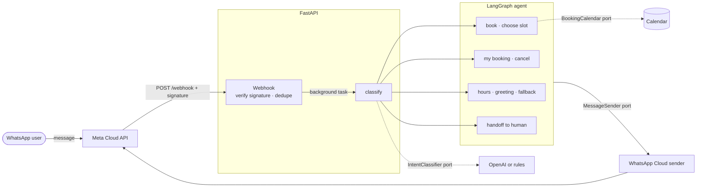

# whatsapp-booking-agent

[](https://github.com/ingCsoto/whatsapp-booking-agent/actions/workflows/ci.yml)

A WhatsApp booking assistant for a small business, in **Python 3.12, FastAPI and LangGraph**. Customers write on WhatsApp and the agent books, shows or cancels their appointment, answers business hours, or hands the chat to a person.

It is built to show the parts that matter in production, not just a prompt:

- **A webhook you can trust.** Every request from Meta is checked with HMAC-SHA256 against the raw body, in constant time, and rejected if it fails. Meta's retries are deduplicated, and the endpoint answers fast and works in the background.
- **A conversation you can reason about.** The dialog is an explicit LangGraph state machine with per-customer memory, not a free-form loop. Every path is covered by tests.
- **An LLM that cannot break the flow.** Intents can come from OpenAI with a strict JSON schema. Any timeout, refusal or invalid answer falls back to deterministic rules.

## Architecture



The domain (`Slot`, `Booking`, `Intent`) and the ports are plain Python. Adapters implement the ports: WhatsApp Cloud API or the console for sending, OpenAI or rules for classifying, and an in-memory calendar.

## The conversation

The graph has one entry node, `classify`, that routes to one handler per intent. State is checkpointed per phone number, so a booking can span several messages:

```text
customer: hola
bot:      ¡Hola! Soy el asistente de Studio Demo. Puedo ayudarte a: …
customer: quiero reservar
bot:      Estos son los próximos horarios disponibles:
          1. lun 2 mar · 09:00
          2. lun 2 mar · 11:00
          3. lun 2 mar · 14:00
          Responde con el número que prefieras.
customer: 2
bot:      ¡Listo! Tu cita quedó para el lun 2 mar · 11:00. Te esperamos.
```

Rules that keep the dialog safe:

- A number only books when slots were just offered, and only if it is within range.
- If someone else takes the slot in between, the customer gets a fresh list instead of a double booking.
- After a handoff to a human the bot stays silent until the customer writes «menu».
- Each customer has an independent conversation.

## Webhook security

| Check | Behavior |
|---|---|
| Missing, malformed or wrong `X-Hub-Signature-256` | 403, nothing is processed |
| Non-ASCII signature header | Rejected without raising, so a hostile header cannot cause a 500 |
| Same message id delivered twice | Processed once, with a bounded, time-limited memory |
| Status updates (sent, delivered, read) | Acknowledged, no reply |
| Non-text messages | A short "text only" answer |
| Verification handshake | Token compared in constant time |

Secrets are loaded as `SecretStr`, so they never appear in logs or error messages.

## Run it locally

Requirements: [uv](https://docs.astral.sh/uv/).

```bash
cp .env.example .env          # set WHATSAPP_APP_SECRET and WHATSAPP_VERIFY_TOKEN to any values
uv sync
uv run uvicorn booking_agent.app:create_app --factory --port 8000
```

Without WhatsApp credentials, replies are printed to the console. Without an OpenAI key, intents use the rules. Talk to it with signed, Meta-shaped webhooks:

```bash
export WHATSAPP_APP_SECRET=<the same value as in .env>
uv run python scripts/simulate.py 15550001111 "hola"
uv run python scripts/simulate.py 15550001111 "quiero reservar"
uv run python scripts/simulate.py 15550001111 "2"
```

To connect a real number, set `WHATSAPP_ACCESS_TOKEN` and `WHATSAPP_PHONE_NUMBER_ID`, expose the app over HTTPS, and register `https://<your-host>/webhook` in your Meta app.

Docker:

```bash
docker build -t whatsapp-booking-agent .
docker run --env-file .env -p 8000:8000 whatsapp-booking-agent
```

## Quality gates

```bash
uv run ruff format --check .
uv run ruff check .
uv run mypy src tests      # strict
uv run pytest -q
```

| Suite | What it proves |
|---|---|
| `test_signature.py` | Valid, tampered, wrong-secret, missing, malformed and non-ASCII signatures. |
| `test_webhook.py` | The HTTP flow: handshake, rejected requests, replies, retries processed once, status updates, non-text messages. |
| `test_agent_graph.py` | Full multi-turn conversations on the real graph, including race conditions, out-of-range choices and handoff. |
| `test_openai_classifier.py` | Strict schema request and fallback to rules on errors, bad JSON and unknown labels. |
| `test_whatsapp_sender.py` | The exact request sent to the WhatsApp Cloud API and error handling. |
| `test_intents.py`, `test_dedupe.py` | Rule matching and the bounded deduplication memory. |

The security tests were checked against mutants. A signature check that always passes breaks 3 tests, and disabling deduplication breaks 2. A test that cannot fail proves nothing.

## Project structure

```
src/booking_agent
├── domain        models, ports and the in-memory calendar (plain Python)
├── agent         LangGraph state machine and the rule-based classifier
├── llm           OpenAI classifier with strict JSON schema and fallback
├── channels      WhatsApp Cloud API and console senders
├── webhooks      signature check, deduplication and FastAPI routes
├── config.py     settings from the environment (SecretStr)
└── app.py        application factory
```

## Stack

Python 3.12 · FastAPI · LangGraph · Pydantic v2 · httpx · OpenAI SDK · uv · Ruff · mypy (strict) · pytest · Docker · GitHub Actions

## License

MIT
